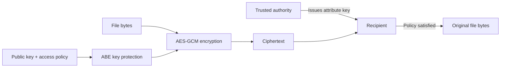

# What is post-quantum CP-ABE?

**Ciphertext-policy attribute-based encryption (CP-ABE)** lets a sender encrypt
under an access rule instead of naming every recipient. A trusted authority
issues user keys with attributes. A recipient can decrypt only when their key
satisfies the ciphertext's policy.

**Post-quantum CP-ABE** adds the requirement that the public-key mechanism
protecting the data key is designed to resist quantum attacks. In this SDK,
CoverCrypt provides that path in `HYBRIDIZED` or `POST_QUANTUM` mode. AC17 and
TKN20 provide classical ABE alternatives.

## A policy instead of a recipient list

Suppose a report has the policy:

```text
department::finance && role::admin
```

| Attributes in a user key | Can decrypt? |
| --- | --- |
| `department::finance role::admin` | Yes |
| `department::finance role::viewer` | No |
| `department::engineering role::admin` | No |

These qualified attributes refer to dimensions declared when the CoverCrypt
authority is created. The examples use non-hierarchical dimensions. The
authority decides who is entitled to each attribute; a user cannot grant
themselves access by editing a string in the application.

The [Python file tutorial](../bindings/python/encrypt-files.md) and
[JavaScript file tutorial](../bindings/wasm/encrypt-files.md) implement this
exact policy and check that a viewer's key is rejected.

## How the hybrid encryption pipeline works

The SDK encrypts the bulk payload with AES-GCM and uses the selected ABE backend
to protect the key material needed to recover that payload. It does not apply
expensive public-key operations separately to every byte of a large file.



The sender needs the public key, the policy and the plaintext. The authority
retains the master secret, and recipients hold their own issued user keys.
For implementation and wire-format details, see the
[cryptographic workflows](detail.md) and [ciphertext format](../native/parameters.md).

## Where post-quantum protection comes from

CoverCrypt is described by [Cosmian](https://docs.cosmian.com/encrypt/covercrypt.html)
as post-quantum public-key encryption with access policies. Its
[security analysis](https://ir.cwi.nl/pub/36050/) studies a policy-based KEM
construction in the CP-ABE vein. This SDK exposes it alongside AC17 and TKN20
through a common interface.

| CoverCrypt mode | Key-encapsulation components in this SDK | Intended use |
| --- | --- | --- |
| `CLASSIC` | Curve25519 | Classical mode; no post-quantum confidentiality claim |
| `POST_QUANTUM` | ML-KEM-768 | Post-quantum key encapsulation |
| `HYBRIDIZED` | Curve25519 + ML-KEM-768 | Combined classical and post-quantum key encapsulation; SDK default |

[NIST FIPS 203](https://csrc.nist.gov/pubs/fips/203/final) specifies ML-KEM,
a mechanism for establishing shared secrets that can then be used with
symmetric cryptography. The CoverCrypt backend in this build uses ML-KEM-768;
the standalone ML-KEM primitive's other parameter sets do not change CoverCrypt.

Here, **hybrid payload encryption** means combining public-key key protection
with symmetric AES-GCM encryption. **Hybridized CoverCrypt** means combining
classical and post-quantum KEM components. These describe different layers.

## Encryption and signatures solve different problems

ABE controls who can recover the data key. AES-GCM encrypts and authenticates
the payload. Optional ML-DSA signatures provide sender authentication when
checked against a trusted verification key.

Adding ML-DSA to AC17 or TKN20 does not make their key protection post-quantum.
For a signed workflow, use `decrypt_and_verify` in Python or `decryptAndVerify`
in JavaScript, rather than treating ordinary decryption as signature verification.
See the [Python signing example](../bindings/python/README.md#signed-encryption-ml-dsa)
or [JavaScript signing API](../bindings/wasm/api.md#object-interface-pqcpabe-and-scheme-classes).

## What an application still manages

Attributes are only as trustworthy as the authority's issuance process. Keep
master secrets away from storage providers and recipient clients, distribute
public keys through authenticated channels, and retain user keys securely.
Adding an attribute or dimension does not automatically revoke previously
issued rights. See [authority management](README.md#extend-a-covercrypt-authority).

Encryption cannot prevent an authorized recipient from copying plaintext or
protect an already compromised endpoint. It also does not by itself hide file
sizes or application metadata.

## Choose your next step

- [AC17 vs TKN20 vs CoverCrypt](scheme-comparison.md): choose a scheme and KEM mode.
- [Encrypt files with Python](../bindings/python/encrypt-files.md) or [JavaScript](../bindings/wasm/encrypt-files.md): run the policy example.
- [Published benchmarks](benchmarks.md): compare the recorded workloads and configurations.
